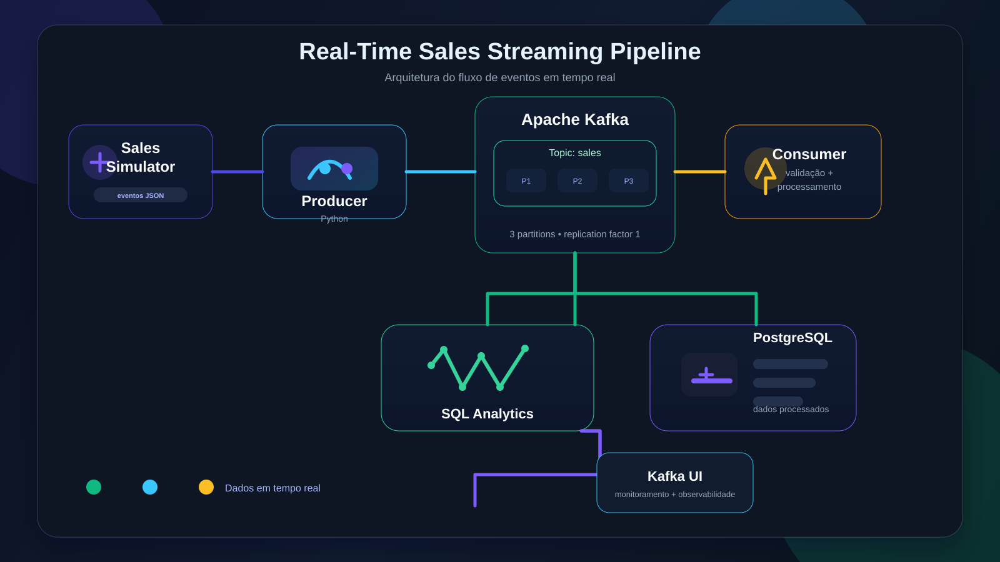

# 🚀 Real-Time Sales Streaming Pipeline

<div align="center">


</div>

A real-time streaming solution to simulate, process, and store online sales through Kafka, Python, and PostgreSQL.

## Overview

This project demonstrates an event-driven architecture in which sales events are generated in Python, published to a Kafka topic, validated and processed by a consumer, and stored in a relational database for later analysis.

The main goal is to practice key data engineering and streaming concepts: event production, topic distribution, parallel processing, persistence, and observability.

### Project highlights

- 🔁 Real-time data pipeline
- 🧠 Sales event simulation in Python
- ⚡ Event publication and consumption with Kafka
- 🗄️ Storage in PostgreSQL
- 📊 Practical experience with data analysis and monitoring

<div align="center">

| Message | Process | Result |
| --- | --- | --- |
| Sales event generated | Producer publishes to Kafka | Message becomes available for consumption |
| Kafka distributes the event | Partitions process in parallel | High scalability |
| Consumption and validation | Consumer reads and cleans the data | Data ready for persistence |
| Persistence | PostgreSQL receives the sales data | Analytical base for queries |

</div>

<div align="center">

<table>
  <tr>
    <td><strong>Type</strong><br>Portfolio Project</td>
    <td><strong>Area</strong><br>Data Engineering</td>
    <td><strong>Architecture</strong><br>Event-driven</td>
    <td><strong>Status</strong><br>In development</td>
  </tr>
</table>

</div>

## Objectives

- Build a real-time event processing system.
- Implement producers and consumers in Python.
- Understand Kafka architecture and operation.
- Work with topics and partitions.
- Integrate Kafka with PostgreSQL.
- Validate and handle errors in incoming events.
- Use Docker to orchestrate the local infrastructure.
- Run SQL queries to analyze sales data.
- Document and version the project with Git and GitHub.

## 🏗️ Solution architecture

The image below represents the complete data flow, from event generation to final analysis.

<div align="center">
  
</div>

### Solution flow

- Sales simulation in Python.
- Event publication to the `sales` topic.
- Distribution across Kafka partitions.
- Consumption, validation, and data processing.
- Persistence in PostgreSQL.
- Monitoring with Kafka UI and SQL analysis.

## ⚙️ Tech stack

<div align="left">


</div>

| Technology | Responsibility |
| --- | --- |
| Python | Event production and consumption |
| Apache Kafka | Event streaming and distribution |
| Kafka UI | Cluster monitoring and observability |
| PostgreSQL | Storage of processed data |
| Docker | Local service execution |
| Docker Compose | Container orchestration |
| Git / GitHub | Version control and documentation |
| DBeaver | Query and data analysis |

Technologies planned for future evolution:

- Apache Airflow — orchestration of workflows and batch pipelines.

## 🐳 Docker infrastructure

The infrastructure is managed with Docker Compose and includes the main services of the pipeline.

| Service | Container | Port |
| --- | --- | --- |
| Apache Kafka | `kafka-sales` | `9092` |
| PostgreSQL | `postgres-sales` | `5432` |
| Kafka UI | `kafka-ui` | `8080` |

The environment uses Kafka in KRaft mode, eliminating the need for ZooKeeper.

### Access services

- Kafka: `localhost:9092`
- PostgreSQL: `localhost:5432`
- Kafka UI: `http://localhost:8080`

## 📨 Kafka configuration

The first topic of the project will be:

| Property | Configuration |
| --- | --- |
| Topic | `sales` |
| Partitions | `3` |
| Replication Factor | `1` |
| Cleanup Policy | `delete` |

The three partitions allow the distribution of events and enable consumer parallelism. Since the environment uses only one broker, the replication factor is 1.

## 🧾 Example sales event

Events are transmitted in JSON format.

```json
{
  "sale_id": 1001,
  "product": "Laptop",
  "quantity": 2,
  "price": 850.00,
  "timestamp": "2026-10-30T15:30:00"
}
```

Each event represents a sale made in an online store. The producer is responsible for generating and publishing the data to the `sales` topic, while the consumer reads, validates, and processes the messages before persisting them in PostgreSQL.

## 📁 Project structure

```text
real-time-sales-streaming/
├── assets/
│   └── architecture.svg
├── config/
│   └── settings.py
├── producer/
│   └── sales_producer.py
├── consumer/
│   └── sales_consumer.py
├── database/
│   └── init.sql
├── docker/
│   └── docker-compose.yml
├── logs/
├── .env.example
├── .gitignore
├── requirements.txt
├── README.md
└── tests/
```

The structure may change as implementation evolves.

## 🗺️ Development plan

| Stage | Activity | Status |
| --- | --- | --- |
| 1 | Project structure | Completed |
| 2 | Docker infrastructure setup | Completed |
| 3 | Create the `sales` topic | Next step |
| 4 | Python producer development | Pending |
| 5 | Python consumer development | Pending |
| 6 | PostgreSQL integration | Pending |
| 7 | Validation and error handling | Pending |
| 8 | Testing and monitoring | Pending |
| 9 | Documentation and GitHub publishing | Pending |

## ▶️ How to run the project

### Prerequisites

- Windows
- Python 3
- Docker Desktop
- Docker Compose
- Git

### Start the infrastructure

At the project root, run:

```powershell
docker compose up -d
```

### Check the containers

```powershell
docker compose ps
```

### View the logs

```powershell
docker compose logs -f
```

### Access Kafka UI

Open in the browser:

```text
http://localhost:8080
```

### Stop the services

```powershell
docker compose down
```

Persistent data is kept in Docker volumes unless explicitly removed.

## 🎯 Expected results

By the end of the project, the goal is to have a functional solution capable of:

- Simulating sales through events generated in Python.
- Publishing events to Apache Kafka.
- Distributing events across a topic with three partitions.
- Consuming and processing events in Python.
- Validating incoming data.
- Storing sales in PostgreSQL.
- Querying and analyzing data via SQL.
- Monitoring the event flow through Kafka UI.

## 🧠 Skills developed

This project helps build practical skills in:

- Data Engineering
- Event-Driven Architecture
- Real-Time Data Streaming
- Apache Kafka
- Python Programming
- PostgreSQL and SQL
- Docker and Docker Compose
- Data Validation
- Git and GitHub
- Data Pipeline Development

## 🚀 Future evolution

In a later phase, the project aims to integrate Apache Airflow to orchestrate data processes, including batch tasks and pipeline coordination.

Other possible improvements include:

- Structured logging implementation.
- Handling invalid messages.
- Dead Letter Queue (DLQ).
- Metrics monitoring.
- Automated testing.
- Sales KPI dashboard.

---

<div align="center">


</div>

Project: Real-Time Sales Streaming Pipeline  
Area: Data Engineering  
Type: Portfolio Project  
Status: In development

Developed as a practical learning project to demonstrate data engineering skills and real-world streaming concepts.